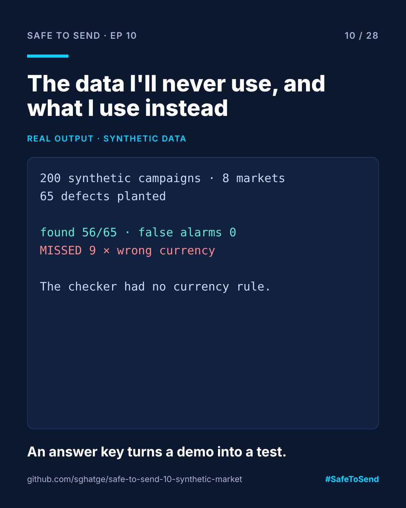

<div align="center">


**SAFE TO SEND · GOVERNED AI ENGINEERING SERIES · SAFE TO SEND 10 SYNTHETIC MARKET**

[GitHub Profile](https://github.com/sghatge) · [Portfolio](https://sghatge.github.io/adobe-campaign-v8-governance/)

</div>

---

# safe-to-send-10 · Synthetic Market



**Safe to Send · Episode 10** — a 28-day learn-in-public series on governing AI in CRM operations.

> No real data, ever. But synthetic data with known answers turns a demo into a test.

## The real-world scenario

Every CRM demo needs data, and every real export carries customer and employer risk, even "just for testing", even redacted. Most teams fall back on made-up data that's too clean to prove anything.

## The use case

Generate a fictional market with defects planted on purpose and an answer key kept separately. Run any QA checker over it and score the checker against the key. If a planted defect isn't found, the check is wrong, not the data.

## Run it

```bash
python synth_market.py 40
```

Writes `out_campaigns.json` (what the checker sees) and `out_answer_key.json` (what was planted), then scores the bundled basic checker.

## Real example: the checker I thought was complete

The basic checker covers 5 defect types. The market plants 6. Across 200 seeded campaigns with 65 planted defects, it found 56, with zero false alarms. It found every unsubscribe, timing, consent, price-format and proof defect, and missed **all 9 wrong-currency defects** (forint in a euro market, koruna in a forint market).

```
200 synthetic campaigns across 8 markets, 65 defects planted
basic checker found 56/65, false alarms 0
  MISSED 9 x wrong_currency
```

I would never have noticed with a clean demo dataset. The answer key made the blind spot impossible to miss.

## Use it on your own checker

```python
from synth_market import generate, score
campaigns, key = generate(200, defect_rate=0.4, seed=1)
print(score(my_checker, campaigns, key))
```

Same seed, same market, every time. Commit the seed, not the data.

Fictional brand, synthetic data only. MIT · [Sangram Ghatge](https://www.linkedin.com/in/sangram-g-2369705b) · #SafeToSend
